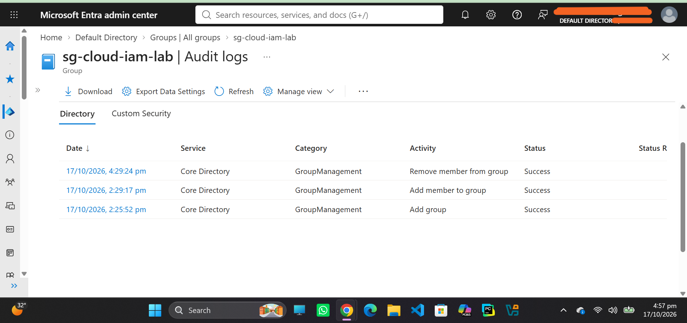
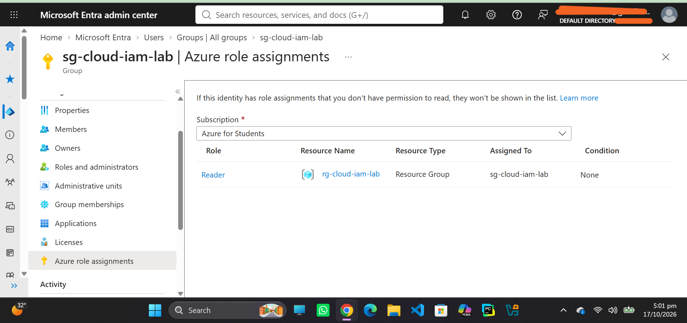
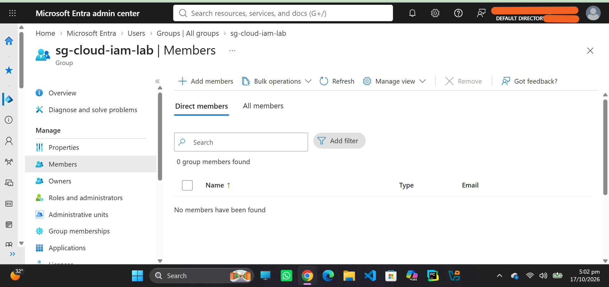
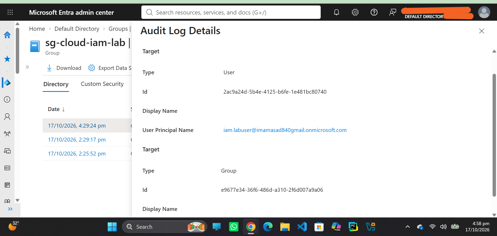

# Cloud IAM Security & Identity Lifecycle Lab — Microsoft Azure

## 1. Project Overview

This project demonstrates fundamental Identity and Access Management (IAM) concepts using Microsoft Azure and Microsoft Entra ID. The lab focuses on authentication, group-based access management, Azure Role-Based Access Control (RBAC), least privilege, and access revocation.

The lab was implemented in an Azure for Students environment without deploying additional billable resources.

## 2. Objectives

- Understand authentication and multi-factor authentication (MFA).
- Create and manage a test identity in Microsoft Entra ID.
- Use security groups for centralized access management.
- Assign Azure RBAC roles at a specific resource-group scope.
- Apply the principle of least privilege.
- Demonstrate access revocation by removing a user from a security group.
- Verify permissions through the Azure Portal.

## 3. Environment and Components

| Component | Configuration |
|---|---|
| Cloud platform | Microsoft Azure |
| Identity provider | Microsoft Entra ID |
| Subscription | Azure for Students |
| Resource group | `rg-cloud-iam-lab` |
| Security group | `sg-cloud-iam-lab` |
| Test identity | `IAM Lab User` |
| Assigned role | Reader |
| Role assignment scope | `rg-cloud-iam-lab` |

## 4. Lab Architecture

The test user receives access through a security group rather than through an individual role assignment.

**Access flow:**

`IAM Lab User` → `sg-cloud-iam-lab` → `Reader role` → `rg-cloud-iam-lab`

The Reader role allows viewing supported resources and settings within its scope, but does not grant general permission to modify resource configurations.

## 5. Implementation

### Step 1: Authentication and MFA

- Created a test user in Microsoft Entra ID.
- Signed in using the test account.
- Completed the initial password-change requirement.
- Configured Microsoft Authenticator during the initial sign-in process.

**Result:** The test identity successfully signed in to the Azure Portal.

### Step 2: Security Group Configuration

- Created the security group `sg-cloud-iam-lab`.
- Added `IAM Lab User` as a member.
- Used the group as the centralized identity for the Azure role assignment.

**Result:** The test user became a member of the security group.

### Step 3: Azure RBAC and Least Privilege

- Assigned the built-in **Reader** role to `sg-cloud-iam-lab`.
- Applied the assignment at the `rg-cloud-iam-lab` resource-group scope.
- Signed in as the test user and checked **Access control (IAM) → View my access**.
- Verified the Reader role through the group assignment.

**Result:** The test user could see the resource group while the group membership and role assignment were in place.

### Step 4: Identity Lifecycle and Access Revocation

- Signed out of the test account and returned to the Owner account.
- Removed `IAM Lab User` from `sg-cloud-iam-lab`.
- Confirmed that the group's Members list became empty.
- Verified that the group's Reader role assignment still existed.
- Signed in as the test user and checked the Resource groups list.

**Result:** The Resource groups list appeared empty for the test user. This demonstrated the expected effect of removing group-based access while retaining the role assignment on the group.

## 6. Security Concepts Demonstrated

### Authentication
Verifies a user's identity before access is granted.

### Multi-Factor Authentication
Adds an additional verification step to help protect an account.

### Group-Based Access Management
Allows administrators to manage permissions for multiple users through a security group.

### Role-Based Access Control (RBAC)
Assigns permissions according to a predefined role, such as Reader.

### Least Privilege
Limits access to the permissions and scope required for a task. In this lab, Reader was assigned at the resource-group level rather than at the subscription level.

### Identity Lifecycle and Access Revocation
Demonstrates how removing a user from a group can revoke permissions inherited through that group.

## 7. Verification Evidence

Recommended screenshots for the project repository:

1. Microsoft Entra ID showing the test user.
2. The security group and its membership before removal.
3. The Reader role assignment at the resource-group scope.
4. The test user's **View my access** page before removal.
5. The group's empty Members list after removal.
6. The group's Reader role assignment still present after removal.
7. The test user's empty Resource groups list after removal.

**Security note:** Do not publish passwords, MFA QR codes, recovery codes, access tokens, or unnecessary account identifiers in screenshots.

## 8. Findings and Lessons Learned

- Permissions can be managed centrally through security groups.

- ## Evidence Screenshots

### 1. Identity Lifecycle Audit Logs

### 2. Azure RBAC Role Assignment

### 3. Group Members After Access Revocation

### 4. Access Revocation Audit Details

- Azure RBAC role assignments have defined scopes.
- Removing a user from a group does not automatically delete the group's role assignment.
- Group membership changes can affect a user's effective permissions.
- Access verification is important after an identity or permission change.
- Permission and token updates can take time to propagate; existing sessions may require reauthentication before results become visible.

## 9. Limitations

- This was a foundational learning lab, not a production IAM deployment.
- No application workload or billable cloud resource was deployed.
- The lab did not test privileged access management, automated joiner-mover-leaver workflows, or automated access reviews.
- The access-revocation test used the Azure Portal's visible access state; it was not a formal audit of every possible permission path.

## 10. Conclusion

This lab provided hands-on practice with Microsoft Entra ID, authentication, MFA, group-based access management, Azure RBAC, least privilege, and identity access revocation.

It established a foundation for future work on identity lifecycle automation, privileged access management, access reviews, and cloud security governance.

## 11. Disclaimer

This project was created for educational and portfolio purposes in an authorized Azure environment.
